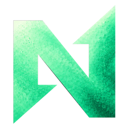
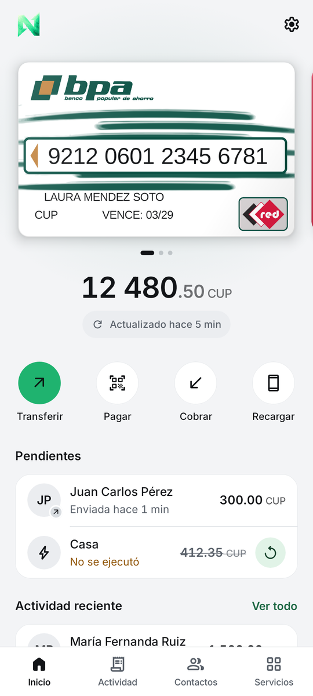
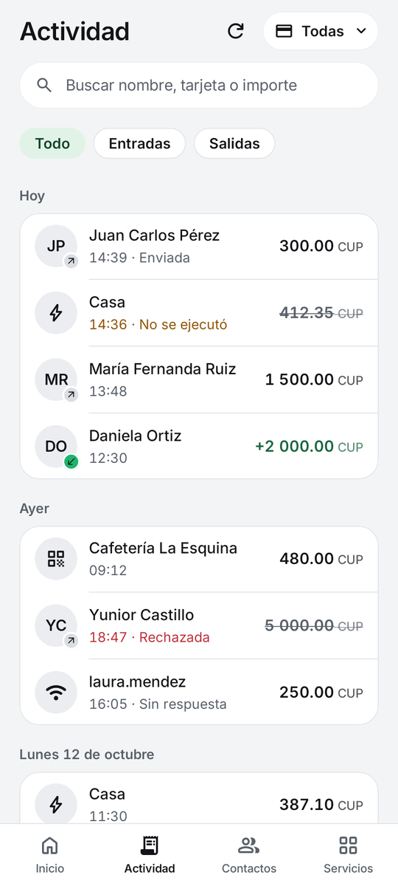
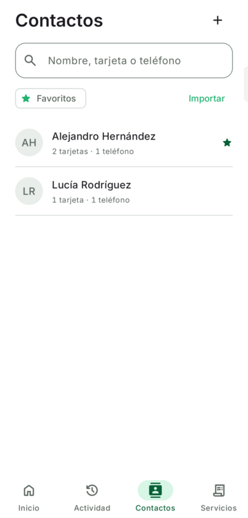

<p align="center">
  
</p>

# NeoTransfer

NeoTransfer es una aplicación Android independiente para gestionar tarjetas, consultas, transferencias, pagos y servicios en Cuba. No está afiliada a ENZONA, ETECSA, Transfermóvil ni a las entidades financieras. Cada operación depende de los servicios disponibles y del registro de su titular.

**Estado:** `1.0.0-dev.6` (`versionCode 8`), una entrega de prueba con integración ENZONA experimental; no es una release 1.0. La [etiqueta v0.2.0](https://github.com/duardor968/NeoTransfer/tree/v0.2.0) conserva la base histórica. Las APIs implementadas proceden de contratos reconstruidos estáticamente: todavía no se ha probado una cuenta ENZONA ni una operación de dinero por ese canal.

<p align="center">
  
  
  
</p>

Capturas de desarrollo con datos ficticios; no demuestran aceptación de operaciones por un proveedor. Los diseños de tarjetas siguen en revisión.

## Alcance

La base etiquetada v0.2.0 incluye acceso biométrico, consulta de saldo, formularios de transferencia y servicios, lectura QR e historial para BPA y BANDEC. La consulta de saldo se probó con una cuenta real; esa prueba no certifica las demás operaciones.

La entrega actual se centra en tarjetas propias BPA y BANDEC, cartera, saldo, transferencias, QR, actividad y comprobantes. ENZONA incorpora APIs de consulta y pago de electricidad, telefonía fija y recarga de cuentas Nauta/Nauta Hogar, además de referencias guardadas. Se conservan los canales USSD de las funciones elegidas, los contactos, la cámara/OCR, la biometría, las notificaciones y el respaldo cifrado. Consulta el [resumen de cobertura](docs/cobertura.md) y el [protocolo](docs/protocolo.md) para distinguir implementación de validación real.

Agua, recarga móvil Cubacel desde banco y pago separado de deuda Nauta Hogar continúan por USSD: sus contratos de envío ENZONA no están demostrados. Los planes y consultas Cubacel desde saldo telefónico, incluido el menú `*133#`, son funciones distintas de una recarga bancaria. No se reenvía dinero automáticamente ni se cambia de ENZONA a USSD después de un fallo.

Quedan fuera las tarjetas propias BANMET, MiTransfer, Clásica, MiTurno, combustible, gas, impuestos, multas, giros y las demás gestiones enumeradas en [cobertura](docs/cobertura.md). La exclusión de tarjetas propias BANMET no excluye destinatarios de otros bancos. Se conserva la recepción de SMS existente; **no hay entrega push ENZONA demostrada con la aplicación cerrada**.

## Requisitos

- Android 15 o posterior y telefonía celular para operaciones USSD.
- Conexión a Internet y una cuenta con tarjetas vinculadas en ENZONA oficial para la prueba de ese canal.
- Biometría fuerte configurada para proteger los accesos bancarios.
- Línea, registro y permisos compatibles con cada servicio. La cámara es opcional para las funciones que la usan.

## Primeros pasos

Esta entrega de desarrollo se prepara para una prueba manual del titular. Una futura publicación se distribuirá desde [GitHub Releases](https://github.com/duardor968/NeoTransfer/releases); la compilación experimental no debe presentarse como una versión estable.

1. Para probar ENZONA, crea la cuenta y vincula primero las tarjetas en la aplicación oficial. El alta nativa de tarjetas en NeoTransfer queda aplazada para esta entrega.
2. Conecta esa cuenta desde NeoTransfer para consultar sus tarjetas. Los accesos BPA/BANDEC por USSD conservan su registro y su línea; la sesión ENZONA y el desbloqueo biométrico local son independientes.
3. Selecciona el producto y el canal de origen antes de consultar, pagar o transferir. Revisa la operación y su resultado; un timeout o un saldo actualizado no confirma un pago.

## Desarrollo

El proyecto usa Kotlin y Jetpack Compose, con `core` para contratos y lógica y `app` para Android. Requiere JDK 21 y Android SDK 36. Las variantes `debug` y `preview` usan identificadores distintos del paquete principal; `preview` usa datos sintéticos. La firma de producción es local y no se necesita para estas variantes.

```powershell
.\gradlew.bat :core:test :app:testDebugUnitTest :app:assembleDebug :app:assemblePreview :app:assembleDebugAndroidTest :app:lintDebug
```

Este comando compila las pruebas instrumentadas, pero no las ejecuta en un dispositivo. [Desarrollo y pruebas](docs/desarrollo.md) explica cómo comprobarlas y qué evidencia falta antes de publicar. [Arquitectura](docs/arquitectura.md) describe las fronteras principales del código. [Protocolo](docs/protocolo.md) distingue los contratos extraídos de resultados bancarios comprobados.

Consulta los [resultados de verificación](docs/verificacion.md) para distinguir las pruebas locales, las realizadas en el teléfono y la aceptación bancaria pendiente.

## Licencia

El código se distribuye bajo [Apache 2.0](LICENSE). Las dependencias, fuentes y recursos de terceros conservan sus licencias y marcas respectivas.

Los cuatro fondos de tarjetas (`card_bpa_red`, `card_bandec_red`, `card_banmet_red` y `card_clasica_personal`) son reconstrucciones gráficas generadas a partir de referencias, no archivos oficiales de las entidades. Sus marcas identifican los productos representados. Los fondos no contienen números, nombres ni vencimientos personales: la aplicación dibuja esos datos por separado. Su fidelidad visual sigue en revisión.
