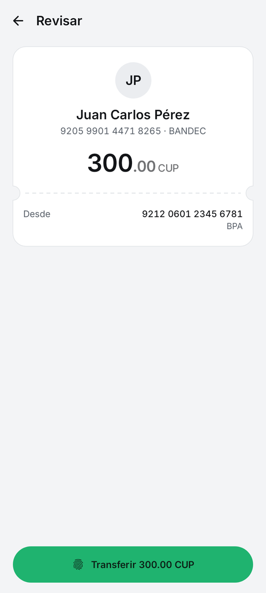

<p align="center">
  
</p>

<h1 align="center">NeoTransfer</h1>

<p align="center">
  Tus tarjetas de BPA, BANDEC y Metropolitano en el teléfono: saldo, transferencias, pagos con QR y servicios. Funciona sin datos móviles.
</p>

<p align="center">
  <a href="https://github.com/duardor968/NeoTransfer/releases/latest"><b>Descargar el APK</b></a>
</p>

<p align="center">
  
  
  
</p>

NeoTransfer es una app Android independiente. No está afiliada a ETECSA, a Transfermóvil ni a los bancos.

## Qué hace

- **Cartera.** Tus tarjetas de BPA, BANDEC y Metropolitano, en CUP o USD, tal como son, con el número completo y el saldo siempre a la vista.
- **Saldo al día.** Se ajusta con cada comprobante del banco y con cada transferencia que recibes. Lo consultas cuando quieras.
- **Transferir** a cualquier tarjeta: escribe el número, escanéalo o elige un contacto. Si ya enviaste lo mismo y no ha llegado la respuesta, te pregunta antes de repetirlo.
- **Pagar con QR** de comercios y tiendas en línea, desde la cámara, una imagen de la galería o un enlace de pago.
- **Cobrar.** El QR de tu tarjeta, que también lee Transfermóvil, para mostrarlo o compartirlo con el importe que pides.
- **Servicios** desde tu tarjeta: electricidad, teléfono fijo, agua, Nauta Hogar (recarga y deuda), cuenta Nauta y recarga móvil. Con el saldo del teléfono: consultar saldo, datos, minutos, SMS y bonos, comprar paquetes y transferir saldo.
- **Actividad.** Todos tus movimientos con su comprobante, también los que hagas desde Transfermóvil. Al instalar la app, la arma con los SMS del banco que ya tienes.
- **Contactos.** Tu agenda del teléfono, sin importar nada: la lista muestra a quien le mueves dinero, con su último movimiento, y le añades tarjetas a cualquiera. Cuando alguien te transfiere, la notificación dice quién y cuánto.
- **Escáner.** Lee QR y números de tarjeta y de móvil, impresos o escritos a mano. Lo abres desde la app, con «Escanear» al mantener pulsado el icono o desde los Ajustes rápidos.
- **Respaldo** cifrado con contraseña de tus tarjetas, contactos y servicios guardados, sin las claves del banco. También importa el respaldo `.trm` de Transfermóvil.

## Cómo funciona

NeoTransfer usa los mismos códigos USSD que Transfermóvil y lee los SMS que te manda el banco (remitente `PAGOxMOVIL`, y los avisos de `BANDEC`). Por eso funciona con 2G y sin datos móviles.

Envías y sigues: la operación queda «Enviada» y la app queda libre para otra cosa. El resultado aparece cuando llega el SMS, aunque tarde unos minutos, y te avisa si no estás en la app. Si el banco pide autenticarte, NeoTransfer lo hace solo con tu clave guardada. El dinero nunca se reenvía solo.

La 1.0 envía las operaciones con el mismo formato que Transfermóvil y pruebas automáticas lo comprueban, pero no todas se han hecho todavía con dinero real en los dos bancos. Si algo no sale como esperas, abre un [issue](https://github.com/duardor968/NeoTransfer/issues) sin datos personales.

## Requisitos

- Android 15 o más nuevo, de 64 bits.
- Una línea cubana registrada en Transfermóvil con BPA, BANDEC o Metropolitano. NeoTransfer usa esa misma clave; el registro no lo hace. Si el teléfono tiene dos SIM, usa la predeterminada para llamadas.
- Una huella configurada en el teléfono.

## Instalación

NeoTransfer no está en Google Play: se instala desde GitHub.

1. En el teléfono, abre la [última versión](https://github.com/duardor968/NeoTransfer/releases/latest) y descarga el archivo `.apk`.
2. Ábrelo. Android te pedirá permiso para instalar apps desde el navegador o el administrador de archivos: concédelo y toca «Instalar».

Las versiones nuevas se instalan igual, encima de la anterior, y conservan tus datos. Si tenías una versión anterior a la 1.0, la 1.0 empieza de cero: vuelve a guardar tus claves y tarjetas; la actividad se reconstruye sola.

## Primeros pasos

1. Al abrir la app, Android te pide todos los permisos de una vez: SMS y Teléfono, que son imprescindibles, y Cámara, Contactos y Notificaciones.
2. Elige tu banco: BPA, BANDEC o Metropolitano.
3. Escribe la clave de autenticación del banco, la misma de Transfermóvil (4 dígitos en BPA y Metropolitano, 5 en BANDEC), y confírmala con la huella.
4. Añade tus tarjetas de ese banco: escribe el número o escanéalo, y elige CUP o USD. El titular y el vencimiento son opcionales.
5. Toca «Consultar saldo» para ver el saldo por primera vez. La actividad ya aparece con los SMS del banco que tenías.

El otro banco se añade en Ajustes › Bancos y claves. Desde entonces, la app pide la huella al abrirla y al volver después de un minuto fuera.

## Privacidad

- Sin servidores ni cuentas: NeoTransfer solo habla con tu banco, por USSD y SMS. Tarjetas, contactos y actividad se guardan en el teléfono y no entran en las copias de seguridad de Google.
- La clave del banco se guarda cifrada y solo se abre con tu huella. No va en los respaldos.
- La app lee los SMS del banco para saber resultados y saldos; no los muestra ni los manda a ningún sitio.
- Sin analítica ni publicidad, y sin permiso de Internet: la app no puede conectarse a nada. El escáner lee los códigos en el propio teléfono.
- En la pantalla de bloqueo, las notificaciones solo dicen «Transferencia recibida» u «Operación confirmada».

## NeoTransfer+

[NeoTransfer+](https://github.com/duardor968/NeoTransferPlus) es la app hermana para ENZONA: opera por Internet con tu cuenta ENZONA, en vez de por USSD. Son apps independientes; puedes tener las dos.

## Desarrollo

Kotlin y Jetpack Compose, en cuatro módulos: `core` (protocolo y libro de operaciones, Kotlin puro), `designsystem`, `scanner` y `app`. Necesitas JDK 21 (sirve el de Android Studio) y Android SDK 36.

```powershell
.\gradlew.bat :core:test :scanner:testDebugUnitTest :app:testDebugUnitTest :app:assembleDebug
```

- [Desarrollo y pruebas](docs/desarrollo.md): variantes, capturas, pruebas en el teléfono y firma.
- [Arquitectura](docs/arquitectura.md): módulos, el flujo «enviar y seguir», datos y seguridad.
- [Protocolo](docs/protocolo.md): formatos USSD y SMS, con su procedencia.
- [Contribuir](CONTRIBUTING.md) · [Seguridad](SECURITY.md)

## Licencia

[Apache 2.0](LICENSE). Las fuentes Inter y Arimo (OFL) y los iconos Material Symbols (Apache 2.0) conservan sus licencias, incluidas en `app/src/main/assets/licenses/`.

Los fondos de las tarjetas BPA, BANDEC y Metropolitano son reconstrucciones vectoriales hechas a partir de fotos de tarjetas, no archivos oficiales de los bancos; los logotipos y marcas que muestran pertenecen a sus dueños. No contienen datos personales: el número, el titular y el vencimiento los dibuja la app.
